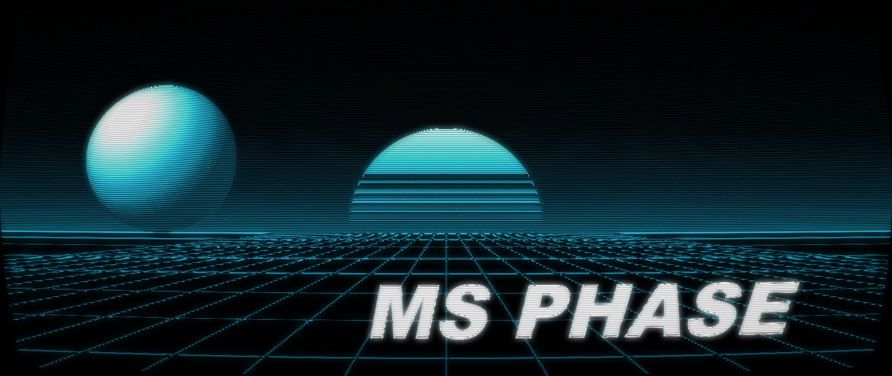
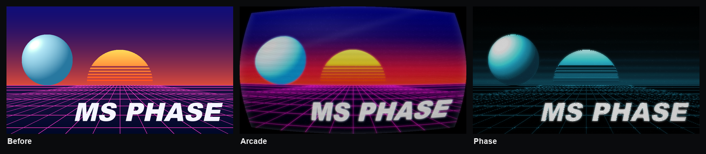
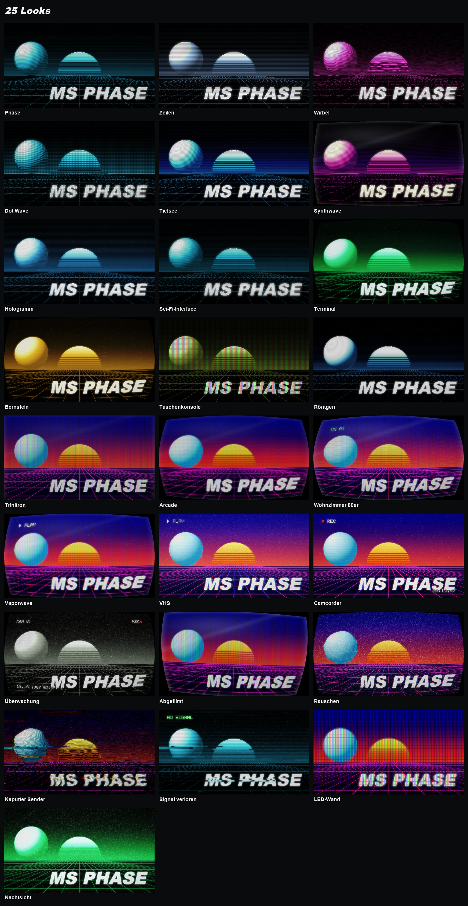
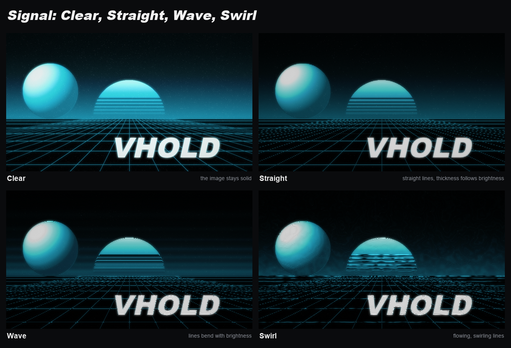
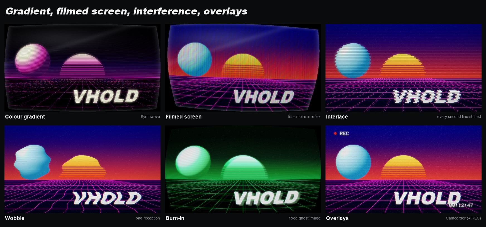
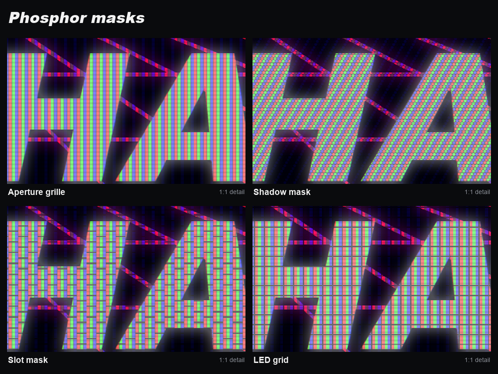

<p align="center">
  
</p>

<p align="center">
  <b>CRT TV look for Photoshop: lines that bend with the image, phosphor masks, scanlines, bloom, curvature
  and interference – for the whole document or single layers, non-destructive.</b><br>
  <sub>Photoshop 2023 (24.2) or newer · UXP panel</sub><br>
  <sub>Free Photoshop tools by <b>Morgenstern</b> · <a href="https://github.com/M0rgenst3rn/ms-distress">Morgenstern Distress</a> · <a href="https://github.com/M0rgenst3rn/ms-printer">Morgenstern Printer</a> · <a href="https://github.com/M0rgenst3rn/ms-render">Morgenstern Render</a> · <b>Morgenstern Phase</b> · <a href="https://github.com/M0rgenst3rn/ms-glow">Morgenstern Glow</a> · <a href="https://github.com/M0rgenst3rn/ms-gradients">Morgenstern Gradients</a></sub>
</p>

---

## What is Morgenstern Phase?

Morgenstern Phase turns your artwork into a picture on a cathode-ray tube. The signal runs across the screen
in lines that, depending on the mode, stay straight, get thicker with brightness, or wrap around shapes like
waves. On top of that there are phosphor masks, scanlines, bloom, curvature, vignette, colour gradients, the
look of a photographed screen, interference like noise, interlacing, wobble and glitch blocks, and overlays in
a pixel font like "▶ PLAY" or "● REC".

Everything is computed procedurally, without any image files. The result lands as real layers with blend
modes in a group; your artwork stays untouched.

<p align="center"></p>

### Highlights

- **Whole document or single layers**: both are non-destructive and can be removed at any time. In layer mode the preview shows the object inside your document
- **4 signal modes**: Clear, Straight, Wave and Swirl
- **25 looks** with previews of your own image
- **Colour gradient**: the signal in two or three colours by brightness, with ready-made gradients
- **Filmed screen**: tilt, moiré and reflection like a photo of a screen
- **Overlays**: channel, playback, recording, volume, date or security camera in a pixel font
- **Phosphor masks**: aperture grille, shadow mask, slot mask and LED grid
- **Real layers**: signal, mask, scanlines, glass, reflex and bloom, each with blend mode and opacity
- **A tidy panel**: collapsible sections, its own colour palette, the essentials on top, everything else in Fine-tuning
- **Preview** of the whole image or a 1:1 detail, plus **Live** in the document
- **Settings live in the group**: select the group and the panel loads its values again
- **Self-test**: 60 checks against the real Photoshop result

## 25 looks

<p align="center"></p>

One click on a look sets every slider. After that every value stays freely adjustable. The look previews in
the panel show each look with your own document or layer.

## Signal

<p align="center"></p>

| Mode | What happens |
|---|---|
| **Clear** | The image stays solid, ideal with mask and scanlines |
| **Straight** | Straight lines that get thicker in bright areas |
| **Wave** | Brightness bends the lines, they wrap around shapes like contour lines |
| **Swirl** | Flowing, swirling lines |

The number of **Lines** covers the whole image height, like a TV's resolution. So the look is the same at any
document size, and the small preview shows the same as the result.

## Gradient, filmed screen, interference, overlays

<p align="center"></p>

- **Colour gradient**: instead of one phosphor colour, the signal runs from black through a dark tone and the
  middle up to a light tone, e.g. Deep sea, Synthwave, Ember, Toxic or Aurora. All three colours are free to choose
- **Filmed screen**: with **Tilt**, **Moiré** and **Reflex** the image looks as if photographed off the screen with
  a phone: slightly rotated, with coloured interference stripes and a reflection on the glass
- **Interlace**: every second line is shifted sideways, like a filmed TV
- **Wobble**: the whole image wobbles in waves, like bad reception
- **Burn-in**: a faint, fixed ghost of the bright parts, like old monitors
- **Overlays**: a pixel font in the signal that curves with the tube and glows with it. Choose from channel
  (CH 03), playback (▶ PLAY), recording (● REC with time), volume, date and time, or security camera. Text,
  colour and size are adjustable; only with "Whole document"

## Phosphor masks

<p align="center"></p>

The mask is the fine RGB grid of a real screen. You see it best in the preview at **1:1**. Set size and
strength in the panel; the strength also later on the layer "Mask".

## The sliders

| Section | Slider | What it does |
|---|---|---|
| Top | **Opacity** | Opacity of the whole group |
| Signal | **Lines / Waves** | Resolution and waves of the lines. Only the sliders that fit the mode appear |
| Colour | **Original / Mono / Gradient** | Original colours, mono in cyan, green, amber, ice blue, magenta, white or your own colour, or a gradient of three colours |
| Screen | **Phosphor mask / Mask strength** | Type and strength of the RGB grid |
| Screen | **Scanlines / Bloom / Bloom radius** | Dark gaps between the lines and glow of bright areas |
| Screen | **Curvature / Vignette / Noise** | Shape of the tube, darker edges and snow |
| Overlay | **Type / Text / Colour / Text size** | Pixel font like a TV or VCR |
| Fine-tuning | **Smoothing / Line thickness / Dots** | Shape of the lines |
| Fine-tuning | **Contrast / Brightness / Mask size** | Contrast and brightness of the signal, size of the RGB grid |
| Fine-tuning | **Round corners / Tilt / Moiré / Reflex / RGB shift / Ghosting** | Tube shape, filmed-screen look, colour fringes and an offset echo of the image |
| Fine-tuning | **Roll bar / Tracking / Glitch / Interlace / Wobble / Burn-in** | Bright bar, jittering lines, shifted blocks, interlacing, wobbling image, fixed ghost |
| Fine-tuning | **Seed** | A new variant of the interference |

## Layers in the document

**Whole document**: a group **"MS Phase"** is created at the top of the document:
```
MS Phase          (group, opacity)
├─ Bloom       Screen
├─ Reflex      Screen (reflection, light rim)
├─ Glass       Multiply (vignette, round corners, moiré)
├─ Scanlines   Multiply
├─ Mask        Multiply
└─ Signal      Normal
```

**Layer only**: every layer gets its own group **"MS Phase · name"**. The original sits inside it unchanged,
and the signal covers exactly its shape, like a screen in the shape of the object. Layer masks of cut-out
objects are respected. Mask, scanlines, glass and reflex are clipped to the signal. Here **Opacity** mixes the
effect with the original. **Remove** puts the original back in the same place.

## Installation

### macOS (recommended)

1. Download the repository (**Code → Download ZIP**) and unzip it
2. Run this in Terminal inside the unzipped folder:
   ```bash
   bash install-mac.sh
   ```
3. (Re)start Photoshop → **Plugins › MS Phase**

### Alternative: UXP Developer Tool (macOS & Windows)

1. Install "UXP Developer Tools" from the Creative Cloud app
2. In Photoshop, turn on **Developer Mode** under *Settings › Plugins*
3. In the UXP Developer Tool choose **Add Plugin**, then `phase/manifest.json` → **Load**

## How to use it

1. **Choose the target**: **Whole document** or **Layer only** below the preview. Below that you see what is being edited
2. **Click a look**: the preview shows the result right away
3. **Fine-tune** with the sliders. **1:1** at the bottom of the preview shows mask and lines at original size
4. Click **Apply** or turn on **Live**
5. **Change it later**: select the group, adjust the values, apply again. The panel loads the group's settings
6. **Remove** deletes the look again. With layers, the original comes back

**Tip:** if your artwork has changed, click "Apply" again. The group is then recomputed.

## Project structure

```
phase/               The plugin (loaded into Photoshop as is)
  manifest.json      Plugin description
  index.html         Panel UI
  ms-ui.js/.css      Shared Morgenstern controls and design
  main.js            Photoshop side (groups, layers, preview, Live, verify, self-test)
  core.js            Effect engine, plain JavaScript
install-mac.sh       Packs the plugin (.ccx) and installs it
tools/               Test renderer, test scene, README images, icons, browser preview of the panel
docs/images/         Example images
```

```bash
node tools/render-test.js in.raw 960 540 out.png phase   # render a look without Photoshop
node tools/make-showcase.js                               # rebuild the images of this README (needs Python with Pillow)
```

## Found a bug? Got an idea?

Get in touch! The easiest way is **[Issues](https://github.com/M0rgenst3rn/ms-phase/issues)** here on GitHub:
click **New issue** and briefly describe what happened. Your Photoshop version, operating system and a
screenshot help a lot. All you need is a free GitHub account. Suggestions and feature requests are just as
welcome.

## License

[MIT with the Commons Clause](LICENSE): the plugin is free. You may use it for any work, including paid
client work, and you may read, change and share the code.
You may not sell the plugin or a version of it (changed or not), or charge for a product or service whose
value comes mainly from it.
Everything you create with it (designs, images, prints) is yours, and you may sell it.
The license notice stays in copies.

Adobe and Photoshop are trademarks of Adobe Inc. This project is independent and not affiliated with Adobe.

---

<p align="center"><sub>Morgenstern Phase<br>
Made by Linus Leinberger</sub></p>
