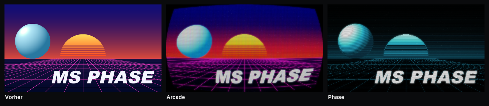
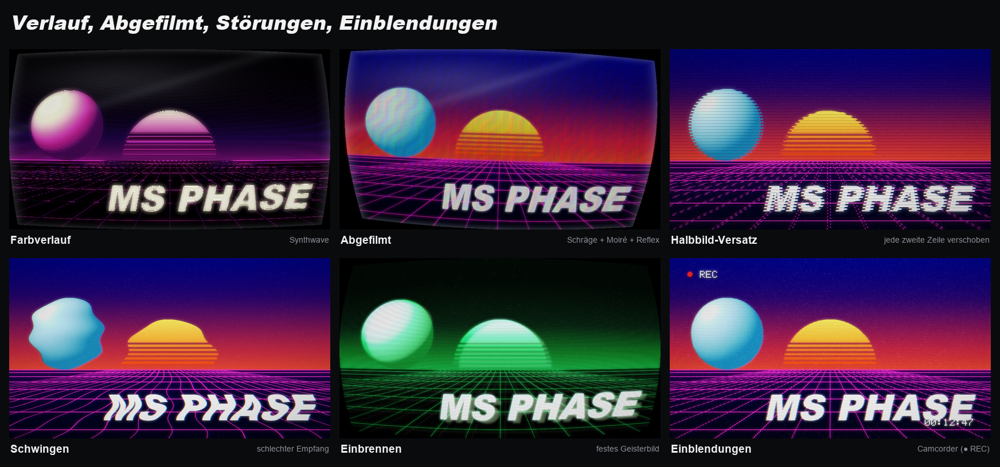

<p align="center">
  
</p>

<p align="center">
  <b>Röhrenfernseher-Look für Photoshop: Zeilen, die sich mit dem Bild biegen, Phosphor-Masken, Scanlines,
  Leuchten, Wölbung und Störungen – für das ganze Dokument oder einzelne Ebenen, nicht-destruktiv.</b><br>
  <sub>Photoshop 2023 (24.2) oder neuer · UXP-Panel</sub><br>
  <sub>Freie Photoshop-Tools von <b>Morgenstern</b> · <a href="https://github.com/M0rgenst3rn/ms-distress">Morgenstern Distress</a> · <a href="https://github.com/M0rgenst3rn/ms-printer">Morgenstern Printer</a> · <a href="https://github.com/M0rgenst3rn/ms-render">Morgenstern Render</a> · <b>Morgenstern Phase</b> · <a href="https://github.com/M0rgenst3rn/ms-glow">Morgenstern Glow</a></sub>
</p>

---

## Was ist Morgenstern Phase?

Morgenstern Phase verwandelt dein Artwork in ein Bild auf einer Röhre. Das Signal läuft in Zeilen über den Schirm,
die je nach Modus gerade bleiben, mit der Helligkeit dicker werden oder sich wellenförmig um Formen legen.
Dazu kommen Phosphor-Masken, Scanlines, Leuchten, Wölbung, Vignette, Farbverläufe, der Look eines
abfotografierten Bildschirms, Störungen wie Rauschen, Halbbild-Versatz, Schwingen und Glitch-Blöcke sowie
Einblendungen in Pixelschrift wie „▶ PLAY“ oder „● REC“.

Alles wird prozedural berechnet, ganz ohne Bilddateien. Das Ergebnis landet als echte Ebenen mit Mischmodus in
einer Gruppe, dein Artwork bleibt unverändert.

<p align="center"></p>

### Highlights

- **Ganzes Dokument oder einzelne Ebenen**: Beides ist nicht-destruktiv und lässt sich jederzeit entfernen. Im Ebenen-Modus zeigt die Vorschau das Objekt in deinem Dokument
- **4 Signal-Modi**: Klar, Gerade, Welle und Wirbel
- **25 Looks** mit Vorschaubildern deines eigenen Motivs
- **Farbverlauf**: Signal in zwei oder drei Farben je nach Helligkeit, mit fertigen Verläufen
- **Abgefilmt**: Schräge, Moiré und Spiegelung wie auf einem Foto vom Bildschirm
- **Einblendungen**: Kanal, Wiedergabe, Aufnahme, Lautstärke, Datum oder Überwachungskamera in Pixelschrift
- **Phosphor-Masken**: Streifenmaske, Lochmaske, Schlitzmaske und LED-Raster
- **Echte Ebenen**: Signal, Maske, Scanlines, Glas, Reflex und Leuchten, jeweils mit Mischmodus und Deckkraft
- **Vorschau** des ganzen Bilds oder als Detail in 1:1, dazu **Live** im Dokument
- **Einstellungen in der Gruppe**: Gruppe auswählen, und das Panel lädt ihre Werte wieder
- **Selbsttest**: 60 Prüfungen gegen das echte Photoshop-Ergebnis

## 25 Looks

<p align="center"></p>

Ein Klick auf einen Look setzt alle Regler. Danach bleibt jeder Wert frei einstellbar. Die Vorschaubilder im
Panel zeigen jeden Look mit deinem eigenen Dokument oder deiner Ebene.

## Signal

<p align="center"></p>

| Modus | Was passiert |
|---|---|
| **Klar** | Das Bild bleibt geschlossen, ideal mit Maske und Scanlines |
| **Gerade** | Gerade Zeilen, die an hellen Stellen dicker werden |
| **Welle** | Die Helligkeit verbiegt die Zeilen, sie legen sich wie Höhenlinien um Formen |
| **Wirbel** | Fließende, verwirbelte Zeilen |

Die **Zeilenzahl** gilt für die ganze Bildhöhe, wie die Auflösung eines Fernsehers. So sieht der Look bei
jeder Dokumentgröße gleich aus, und die kleine Vorschau zeigt dasselbe wie das Ergebnis.

## Verlauf, Abgefilmt, Störungen, Einblendungen

<p align="center"></p>

- **Farbverlauf**: Statt einer Phosphor-Farbe läuft das Signal von Schwarz über einen dunklen Ton und die
  Mitte bis zu einem hellen Ton, etwa Tiefsee, Synthwave, Glut, Gift oder Polarlicht. Alle drei Farben sind frei wählbar
- **Abgefilmt**: Mit **Schräge**, **Moiré** und **Reflex** sieht das Bild aus wie mit dem Handy vom Bildschirm
  fotografiert: leicht gedreht, mit farbigen Interferenzstreifen und einer Spiegelung auf dem Glas
- **Halbbild-Versatz**: Jede zweite Zeile ist seitlich verschoben, wie bei einem abgefilmten Fernseher
- **Schwingen**: Das ganze Bild schwingt wellenförmig, wie bei schlechtem Empfang
- **Einbrennen**: Ein schwaches, festes Geisterbild der hellen Bildteile, wie bei alten Monitoren
- **Einblendungen**: Pixelschrift im Signal, die sich mit der Röhre wölbt und mitleuchtet. Zur Auswahl stehen
  Kanal (CH 03), Wiedergabe (▶ PLAY), Aufnahme (● REC mit Zeit), Lautstärke, Datum und Uhrzeit oder
  Überwachungskamera. Text, Farbe und Größe sind einstellbar, nur bei „Ganzes Dokument“

## Phosphor-Masken

<p align="center"></p>

Die Maske ist das feine RGB-Raster eines echten Bildschirms. Am besten siehst du sie in der Vorschau unter
**1:1**. Größe und Stärke stellst du im Panel ein, die Stärke auch später an der Ebene „Maske“.

## Die Regler

| Bereich | Regler | Was er macht |
|---|---|---|
| Oben | **Deckkraft** | Deckkraft der ganzen Gruppe |
| Signal | **Zeilen / Wellen / Glättung / Linienstärke / Punkte** | Auflösung, Wellen und Form der Zeilen. Es erscheinen nur die Regler, die zum Modus passen |
| Farbe | **Original / Einfarbig / Verlauf** | Originalfarben, einfarbig in Cyan, Grün, Bernstein, Eisblau, Magenta, Weiß oder eigener Farbe, oder ein Verlauf aus drei Farben |
| Farbe | **Kontrast / Helligkeit** | Kontrast und Helligkeit des Signals |
| Bildschirm | **Phosphor-Maske / Maskengröße / Masken-Stärke** | Art und Stärke des RGB-Rasters |
| Bildschirm | **Scanlines / Leuchten / Leucht-Radius** | Dunkle Zeilenlücken und Leuchten heller Stellen |
| Röhre | **Wölbung / Runde Ecken / Vignette** | Form der Röhre und abgedunkelte Ränder |
| Röhre | **Schräge / Moiré / Reflex** | Abfotografiert-Look: gedreht und trapezförmig, Interferenzstreifen, Spiegelung und Lichtsaum |
| Röhre | **RGB-Versatz / Geisterbild** | Farbsäume und ein versetztes Echo des Bilds |
| Störungen | **Rauschen / Bildlauf-Balken / Tracking / Glitch** | Schnee, heller Balken, zitternde Zeilen und verschobene Blöcke |
| Störungen | **Halbbild-Versatz / Schwingen / Einbrennen** | Verschobene Halbbilder, schwingendes Bild, festes Geisterbild |
| Störungen | **Zufall** | Neue Variante der Störungen |
| Einblendung | **Art / Eigener Text / Farbe / Schriftgröße** | Pixelschrift wie bei Fernseher und Videorekorder |

## Ebenen im Dokument

**Ganzes Dokument**: Oben im Dokument entsteht eine Gruppe **„MS Phase“**:
```
MS Phase          (Gruppe, Deckkraft)
├─ Leuchten    Negativ multiplizieren
├─ Reflex      Negativ multiplizieren (Spiegelung, Lichtsaum)
├─ Glas        Multiplizieren (Vignette, runde Ecken, Moiré)
├─ Scanlines   Multiplizieren
├─ Maske       Multiplizieren
└─ Signal      Normal
```

**Nur Ebene**: Jede Ebene kommt in eine eigene Gruppe **„MS Phase · Name“**. Das Original liegt
unverändert darin, das Signal deckt genau seine Form ab, wie ein Bildschirm in Form des Objekts. Ebenenmasken
freigestellter Objekte werden berücksichtigt. Maske, Scanlines, Glas und Reflex sind per Schnittmaske auf das Signal
begrenzt. Die **Deckkraft** mischt den Effekt hier mit dem Original. **Entfernen** stellt das Original
an derselben Stelle wieder her.

## Installation

### macOS (empfohlen)

1. Repository herunterladen (**Code → Download ZIP**) und entpacken
2. Im Terminal im entpackten Ordner ausführen:
   ```bash
   bash install-mac.sh
   ```
3. Photoshop (neu) starten → **Zusatzmodule (Plugins) › MS Phase**

### Alternative: UXP Developer Tool (macOS & Windows)

1. „UXP Developer Tools“ über die Creative-Cloud-App installieren
2. In Photoshop unter *Einstellungen › Zusatzmodule* den **Entwicklermodus** aktivieren
3. Im UXP Developer Tool **Add Plugin** wählen, dann `phase/manifest.json` → **Load**

## So benutzt du es

1. **Ziel wählen**: unter der Vorschau **Ganzes Dokument** oder **Nur Ebene**. Darunter steht, was gerade bearbeitet wird
2. **Look anklicken**: Die Vorschau zeigt das Ergebnis sofort
3. **Feinschliff** mit den Reglern. **1:1** unten in der Vorschau zeigt Maske und Zeilen in Originalgröße
4. **Anwenden** klicken oder **Live** einschalten
5. **Später ändern**: Gruppe auswählen, Werte anpassen, erneut anwenden. Das Panel lädt die Einstellungen der Gruppe
6. **Entfernen** löscht den Look wieder. Bei Ebenen kommt das Original zurück

**Tipp:** Hat sich dein Artwork geändert, klicke erneut auf „Anwenden“. Die Gruppe wird dann neu berechnet.

## Projektstruktur

```
phase/               Das Plugin (wird so in Photoshop geladen)
  manifest.json      Plugin-Beschreibung
  index.html         Panel-Oberfläche
  main.js            Photoshop-Anbindung (Gruppen, Ebenen, Vorschau, Live, Prüfen, Selbsttest)
  core.js            Effekt-Engine, reines JavaScript
install-mac.sh       Packt das Plugin (.ccx) und installiert es
tools/               Test-Renderer, Testszene, Bilder dieser README, Icons
docs/images/         Beispielbilder
```

```bash
node tools/render-test.js in.raw 960 540 out.png phase   # einen Look ohne Photoshop rendern
node tools/make-showcase.js                                # Bilder dieser README neu erzeugen (braucht Python mit Pillow)
```

## Fehler gefunden? Ideen?

Melde dich gern! Am einfachsten über **[Issues](https://github.com/M0rgenst3rn/ms-phase/issues)** hier auf GitHub:
**New issue** klicken und kurz beschreiben, was passiert ist. Hilfreich sind Photoshop-Version, Betriebssystem
und gern ein Screenshot. Dafür brauchst du nur ein kostenloses GitHub-Konto. Verbesserungsvorschläge und
Wünsche für neue Funktionen sind genauso willkommen.

## Lizenz

[MIT](LICENSE): Du darfst den Code frei ansehen, verändern, weitergeben und auch kommerziell nutzen.
Einzige Bedingung: Der Lizenzhinweis bleibt in Kopien enthalten.

Adobe und Photoshop sind Marken von Adobe Inc. Dieses Projekt ist unabhängig und steht in keiner
Verbindung zu Adobe.

---

<p align="center"><sub>Morgenstern Phase<br>
Entwickelt von Linus Leinberger</sub></p>
